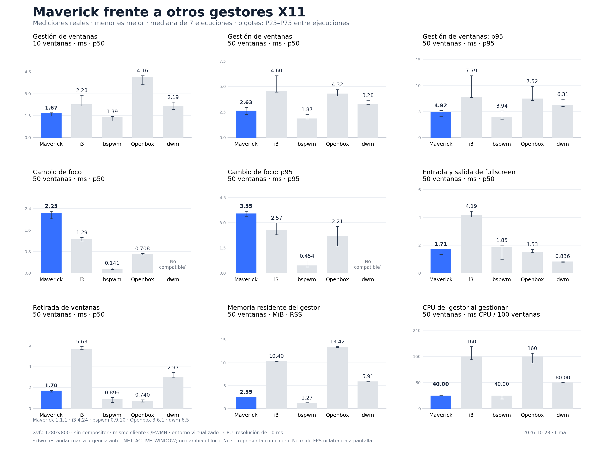

# Campaña de rendimiento X11, 23 de octubre de 2026

Se midió la primera optimización de `manage()` frente a la revisión base y,
después, frente a i3, bspwm, Openbox y dwm. Todas las cifras son reales: 7
repeticiones medidas y un calentamiento por combinación, Xvfb nuevo en cada
ensayo, 10 y 50 ventanas, 500 cambios de foco, 40 transiciones fullscreen y 2
segundos de reposo. Los 32 ensayos A/B y los 80 de la matriz terminaron
correctamente. Menor es mejor en todos los paneles.



## Comparación con la base en el mismo entorno

La versión optimizada adelanta las peticiones de geometría y
`WM_TRANSIENT_FOR` para recibir sus respuestas junto con las demás propiedades
del cliente. `ab/raw.json` retiene cada muestra, `ab/summary.json` las siete
estadísticas por serie y `ab/candidate.patch` el cambio exacto. Binarios SHA-256:
base `819547a9080939ef4c4749faa70eee7edf5f196c7b6465eec431e2edd058e82c`,
candidato `3ad7261a23fa780b93684184d00afada02d4a1aa332b3e6c9b33e7bc4d02e2ec`.

| Panel | Base | Optimizado | Parejas favorables / 7 |
| --- | ---: | ---: | ---: |
| Apertura p50, 10 ventanas (ms) | 1.486 | 1.390 | 4 |
| Apertura p50, 50 ventanas (ms) | 2.622 | 2.047 | 7 |
| Apertura p95, 50 ventanas (ms) | 6.080 | 3.077 | 6 |
| Foco p50, 50 ventanas (ms) | 2.131 | 2.209 | 2 |
| Foco p95, 50 ventanas (ms) | 3.573 | 3.643 | 5 |
| Fullscreen p50, 50 ventanas (ms) | 1.517 | 1.711 | 1 |
| Retirada p50, 50 ventanas (ms) | 1.632 | 1.689 | 2 |
| RSS, 50 ventanas (MiB) | 2.621 | 2.574 | 5 |
| CPU de apertura, 50 ventanas (ms / 100) | 60 | 60 | 4 |

La apertura p50 con 50 ventanas bajó un 22 % y su p95 un 49 % en esta serie.
Foco, fullscreen y retirada no mejoraron; el aumento de la mediana de fullscreen
fue del 13 %. Las mediciones de CPU tienen resolución de 10 ms. El segundo
benchmark se ejecutó más tarde, por lo que sus valores absolutos no sustituyen
la comparación alternada para estimar el efecto del cambio.

También se midieron dos propuestas descartadas. `rejected-buffers/` conserva
una versión que reutilizaba buffers además de agrupar lecturas: empeoró foco,
fullscreen y retirada. `rejected-ewmh/` compara la versión aceptada con otra
que agrupaba publicación EWMH: apertura p50 pasó de 2.247 a 2.658 ms (solo
2/7 parejas favorables), aunque la retirada mejoró en esa serie. Cada
directorio conserva `candidate.patch`, `manifest.json`, `raw.json` y
`summary.json`; ninguno de esos cambios está en el código final.

`rejected-wmstate/` registra otra comparación de siete parejas: quitar la
espera síncrona de `WM_STATE` dio 2.735 → 2.349 ms en apertura p50 con 50
ventanas, pero solo ganó 3/7 parejas; apertura p95 empeoró 4.543 → 4.758 ms
y foco p95 3.656 → 4.800 ms. Se descartó antes de incorporar además el
tratamiento de errores asíncronos que habría exigido esta variante.

## Matriz de cinco gestores

La tabla muestra la mediana de cada gestor en los nueve paneles del gráfico.
El líder se determina solo por la mediana; los intervalos P25–P75 y las siete
observaciones por ejecución están en `five-wm/summary.json` y `runs.csv`.

| Panel | Maverick | Mejor mediana ajena | Resultado |
| --- | ---: | ---: | --- |
| Apertura p50, 10 ventanas (ms) | 1.669 | bspwm 1.392 | Por detrás |
| Apertura p50, 50 ventanas (ms) | 2.630 | bspwm 1.874 | Por detrás |
| Apertura p95, 50 ventanas (ms) | 4.917 | bspwm 3.938 | Por detrás |
| Foco p50, 50 ventanas (ms) | 2.246 | bspwm 0.141 | Por detrás |
| Foco p95, 50 ventanas (ms) | 3.546 | bspwm 0.454 | Por detrás |
| Fullscreen p50, 50 ventanas (ms) | 1.709 | dwm 0.836 | Por detrás |
| Retirada p50, 50 ventanas (ms) | 1.699 | Openbox 0.740 | Por detrás |
| RSS, 50 ventanas (MiB) | 2.551 | bspwm 1.266 | Por detrás |
| CPU de apertura, 50 ventanas (ms / 100) | 40 | bspwm 40 | Empate de mediana |

Maverick no lidera ningún panel de esta matriz. El empate de CPU es grueso por
la cuantización de ticks, y los intervalos entre ensayos se solapan. dwm 6.5
estándar solo marca urgencia ante `_NET_ACTIVE_WINDOW`; su foco figura como
`No compatible`, no como cero ni como una victoria de latencia.

## Verificación y reproducción

`five-wm/manifest.json` registra versiones y hashes de los cinco gestores,
fuentes, kernel, CPU, cuota, bibliotecas, comandos y SHA-256 de `raw.json`.
`five-wm/chart-manifest.json` liga esa entrada al PNG, SVG y PDF. El generador
del gráfico rechaza ensayos fallidos, incompletos o alterados.

En un sistema con las dependencias de [`benchmarks/x11/README.md`](../../x11/README.md),
compilar la rama en release y ejecutar:

```sh
python3 benchmarks/x11/run.py --out /tmp/maverick-five-wm \
  --maverick target/release/maverick --dwm /usr/bin/dwm.default \
  --clients 10 50 --repeats 7 --warmups 1 --focus 500 \
  --fullscreen 40 --idle-seconds 2 --seed 20261023
python3 benchmarks/x11/plot.py /tmp/maverick-five-wm
python3 tests/benchmark-contracts.py
```

La repetición A/B requiere además compilar la base
`807218896c05e3ffdaa565799ab523fca84e418e` en release, conservando ambos
binarios por separado, y ejecutar `tests/benchmark-ab.py` con `--harness
benchmarks/x11 --base RUTA_BASE --candidate RUTA_CANDIDATO --out DIRECTORIO`.
El directorio de salida debe ser nuevo. Los resultados absolutos dependen de la
máquina y su carga. Xvfb no mide FPS ni latencia hasta una pantalla física.

La versión final pasó `cargo fmt --check`, Clippy, los tests Rust de todo el
workspace con funciones normales y con `--all-features`, los siete contratos
del benchmark y la campaña de sondas C. En la pasada Xvfb de 18 casos, 17
pasaron al primer intento; `xvfb-restart.py` agotó una espera de 5 segundos
al reiniciar desde Overview y pasó completo al repetirlo aislado. La variante
de reinicio con foco de puntero también pasó. El primer timeout queda registrado
como limitación de esta validación, no se cuenta como un pase inicial.
